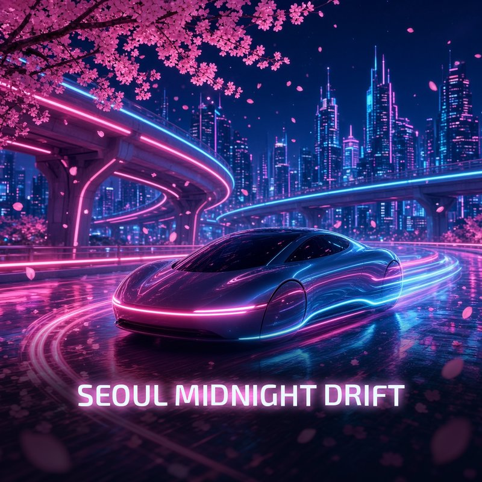

# Free Custom Tesla & Cybertruck Light Show (`.fseq` + `.mp3`) — *Seoul Midnight Drift* by Glow Cadence

[-00E5FF?style=for-the-badge&logo=tesla&logoColor=black)](https://github.com/glowcadence/tesla-cybertruck-free-light-show/releases/latest)
[](https://glowcadence.com)
[](https://teslalightshare.io/light-show/1586)



Welcome to the official free starter repository from **[Glow Cadence](https://glowcadence.com)**! This repository includes the complete, plug-and-play **Seoul Midnight Drift** custom Tesla & Cybertruck Light Show (`LightShow/lightshow.fseq` + `LightShow/lightshow.mp3` + ready-to-unzip [`GlowCadence-Seoul-Midnight-Drift-Free-Show.zip`](./GlowCadence-Seoul-Midnight-Drift-Free-Show.zip)).

> **Want another free custom light show?**
> Sign up free at **[https://glowcadence.com](https://glowcadence.com)** and **claim your first light show free** from our 55-show custom catalog!

---

## Watch *Seoul Midnight Drift* Live on a Real Cybertruck at Night

- **TeslaLightShare.io Listing & Video:** [https://teslalightshare.io/light-show/1586](https://teslalightshare.io/light-show/1586)
- **Reddit `r/xlights` Technical Breakdown & Real Cybertruck Footage:** [https://www.reddit.com/r/xlights/comments/1xfitti/sequenced_a_real_cybertruck_light_show_seoul/](https://www.reddit.com/r/xlights/comments/1xfitti/sequenced_a_real_cybertruck_light_show_seoul/)
- **Download `.zip` Release (with 16:9 HD Preview Video):** [GitHub Release `v1.0.0`](https://github.com/glowcadence/tesla-cybertruck-free-light-show/releases/tag/v1.0.0)

---

## 48-Channel Custom Architecture (Cybertruck + Model S / 3 / X / Y)

Unlike generic templates or random-blinking converters, every Glow Cadence `.fseq` is engineered around a **48-channel beat-locked architecture** mapped directly to kick, snare, sub-bass, and melodic audio transients at **full `255` brightness**:

1. **60-LED Front Lightbar Addressing (Cybertruck):** Smooth knight-rider sweeps, split-bar call-and-response chases, center-out shockwaves, and precision strobe hits across individual front bar segments.
2. **52-LED Rear Tail Lightbar Addressing (Cybertruck):** Synchronized rear bar counter-sweeps, brake-pulse accents, and wide-stance framing.
3. **Off-Road Roof Lightbar & Exterior Projectors:** High/low beam hits, signature DRL pulses, corner markers, fogs, and turn signals locked to snare and cymbal transients.
4. **6-Zone Interior RGB Ambient Strips:** Coordinated cabin color waves and beat pulses across front dash, footwells, and rear doors.
5. **Synchronized Motorized Closures:** Choreographed frunk, power tonneau cover, charge port door, and window movements timed to musical build-ups and drops.
6. **100% Universal Tesla Compatibility:** Runs natively on **Tesla Cybertruck** as well as **Model S, Model 3 (including Highland), Model X, and Model Y (including Juniper)** (`2021+` hardware).

---

## Featured Shows from the 55-Show Glow Cadence Catalog

Explore these 7 signature custom-choreographed shows at **[https://glowcadence.com](https://glowcadence.com)** — **sign up free to claim your first catalog show at $0**, and follow our daily previews on **[@GlowCadenceHQ on X](https://x.com/GlowCadenceHQ)** and the **[Glow Cadence Facebook Page](https://www.facebook.com/GlowCadence)**:

| # | Show Title | Vibe & Choreography Highlights | Watch Preview & Download |
| :-: | :--- | :--- | :--- |
| **1** | **Bones on the Dance Floor** | Spooky Halloween skeleton rave — rapid 60-LED front lightbar rib-cage sweeps, strobe drops, and synchronized closure snaps | [Claim at GlowCadence.com](https://glowcadence.com) · [Watch on X](https://x.com/GlowCadenceHQ/status/2114189057219785057) · [FB Reel](https://www.facebook.com/reel/1162125309667420) |
| **2** | **Iron Longship Thunder** | Epic Viking drekar storm anthem — thunderous war-drum low-beam impacts, lightning-strike roof bar flashes, and rolling ocean wave chases | [Claim at GlowCadence.com](https://glowcadence.com) · [Watch on X](https://x.com/GlowCadenceHQ/status/2114017642948497814) · [FB Reel](https://www.facebook.com/reel/1411051114548356) |
| **3** | **Titans Over Glass Canyon** | Cinematic sci-fi bass odyssey — colossal canyon-echo brass hits with full-width 60-LED + 52-LED horizon sweeps and interior RGB surges | [Claim at GlowCadence.com](https://glowcadence.com) · [Watch on X](https://x.com/GlowCadenceHQ/status/2114017973333852176) · [FB Reel](https://www.facebook.com/reel/28809420642085539) |
| **4** | **Disco Mile Marker** | High-energy nu-disco mirrorball groove —funky slap-bass chases, alternating left/right turn-signal bounce, and sparkling 255-brightness prism sweeps | [Claim at GlowCadence.com](https://glowcadence.com) · [Watch on X](https://x.com/GlowCadenceHQ/status/2114017739811815758) · [FB Reel](https://www.facebook.com/reel/1593663385261087) |
| **5** | **Ignition Petals** | Festival mainstage progressive bloom — euphoric melodic arpeggios expanding outward from center LEDs into a full-vehicle drop | [Claim at GlowCadence.com](https://glowcadence.com) · [Watch on X](https://x.com/GlowCadenceHQ/status/2114018277286613120) · [FB Reel](https://www.facebook.com/reel/2075825069757267) |
| **6** | **Calle Luna Candela** | Latin brass & timbales street fiesta — razor-sharp percussion hits, polyrhythmic front/rear lightbar interplay, and warm fiesta cabin glow | [Claim at GlowCadence.com](https://glowcadence.com) · [Watch on X](https://x.com/GlowCadenceHQ/status/2114018149632971188) · [FB Reel](https://www.facebook.com/reel/4674074089524694) |
| **7** | **Runway Afterburner Alley** | High-octane synthwave jet launch — sequential runway approach strobes, turbine spool-up fades, and twin-afterburner tailbar ignition | [Claim at GlowCadence.com](https://glowcadence.com) · [Watch on X](https://x.com/GlowCadenceHQ/status/2113726651851002060) · [FB Reel](https://www.facebook.com/reel/1093947776728628/) |

---

## Step-by-Step USB Flash Drive Setup Guide

Running **Seoul Midnight Drift** (or any Glow Cadence light show) on your Tesla or Cybertruck takes less than 2 minutes:

1. **Format Your USB Drive:**
   - Format a USB flash drive as **`exFAT`**, **`FAT32`** (Windows), or **`MS-DOS (FAT)`** (macOS Disk Utility).
   - *Important:* Do **not** have a `TeslaCam` folder on the same partition, or use a dedicated USB drive/partition for your Light Shows.
2. **Create the `LightShow` Folder at Root:**
   - At the top-level root directory of your USB drive, make sure there is a folder named exactly:
     ```text
     LightShow
     ```
     *(Case-sensitive: capital `L`, capital `S`, no spaces. If you unzip [`GlowCadence-Seoul-Midnight-Drift-Free-Show.zip`](./GlowCadence-Seoul-Midnight-Drift-Free-Show.zip) directly to your USB root, it creates this folder automatically!)*
3. **Copy the `.fseq` and `.mp3` Files:**
   - Verify these two files are inside the `LightShow` folder:
     ```text
     USB_DRIVE/
     └── LightShow/
         ├── lightshow.fseq
         └── lightshow.mp3
     ```
   - *(Tip: On recent Tesla software updates that support multiple shows per USB drive, you can also name pairs like `Seoul-Midnight-Drift.fseq` + `Seoul-Midnight-Drift.mp3` inside `LightShow/`.)*
4. **Launch in Your Vehicle:**
   - Plug the USB drive into a data-enabled front console USB port or the glovebox USB port.
   - On the Tesla touchscreen, tap **Toybox -> Light Show -> Schedule Show**.
   - Select your custom show, step outside, close all doors, and watch the show!

---

## Official Links & Community

- **Official Website & 55-Show Catalog (1 Free Show on Sign-Up):** [https://glowcadence.com](https://glowcadence.com)
- **X (Twitter):** [@GlowCadenceHQ](https://x.com/GlowCadenceHQ)
- **Facebook Page:** [Glow Cadence](https://www.facebook.com/GlowCadence)
- **TeslaLightShare.io:** [Seoul Midnight Drift (#1586)](https://teslalightshare.io/light-show/1586)
- **Support & Custom Inquiries:** [hello@glowcadence.com](mailto:hello@glowcadence.com)

---

### Disclaimer

*Not affiliated with Tesla, Inc. "Tesla", "Cybertruck", "Model S", "Model 3", "Model X", and "Model Y" are trademarks of Tesla, Inc., used strictly to indicate vehicle compatibility for custom xLights `.fseq` sequences.*
